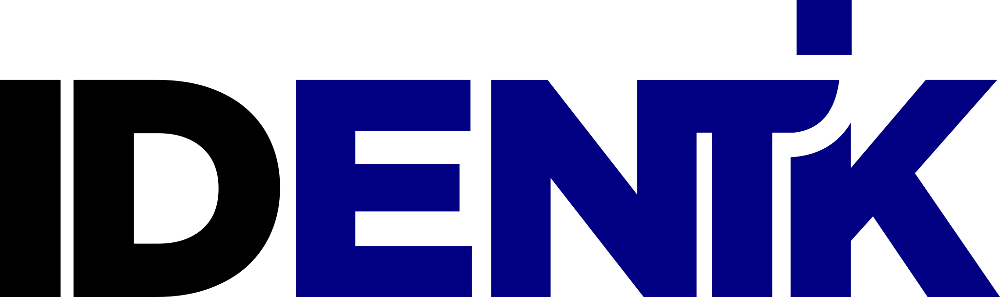

# Identik para Claude

Consulte documentos, prepare borradores desde plantillas y obtenga PDFs firmados y constancias de **Firma Digital** y **Firma Electrónica** desde Claude. Una conexión permite trabajar con una o ambas plataformas, según los equipos que autorice.

El plugin incluye un conector MCP con OAuth y una skill para organizar el trabajo. **Cada persona autoriza su firma en Identik**: el asistente no firma por los destinatarios. Enviar documentos o recordatorios requiere revisar y confirmar la acción.

## Instalación

### Claude Code

Instale desde el repositorio de Identik:

```sh
claude plugin marketplace add Identik-me/identik-claude-plugin
claude plugin install identik@identik
```

Reinicie la sesión. Abra `/mcp`, seleccione el servidor de Identik y complete la autenticación en el navegador. Puede iniciar la guía con `/identik:documentos`.

### Claude web y Cowork

La inclusión en el directorio de Anthropic requiere su revisión; no se afirma que esta versión esté aprobada o publicada allí. Mientras tanto, puede agregar el **conector personalizado** desde Configuración → Conectores, con esta URL:

```text
https://claude-connect.identik.me/mcp
```

El conector personalizado habilita las herramientas. La skill se distribuye con el plugin y no se instala por agregar solamente la URL del MCP.

## Vincular una cuenta

1. Necesita una cuenta de Identik y permiso para administrar el equipo. En Configuración del equipo → API Tokens, cree un token dedicado a esta conexión.
2. Inicie la conexión desde Claude. En la página de **Identik**, ingrese el token de Firma Digital, el de Firma Electrónica o ambos; deje vacío el que no utilice.
3. Revise los permisos y seleccione **Vincular cuentas**. Puede autorizar sólo consultas o agregar preparación de borradores y envíos.

No comparta tokens, contraseñas, DNI/CUIL, PIN, códigos de firma ni material biométrico en el chat. La identidad se completa en Identik. Los tokens de ambas plataformas son independientes.

## Ejemplos

| Lo que puede pedir | Resultado esperado |
|---|---|
| «Consulte mis créditos y plantillas de Firma Electrónica.» | `estado_cuenta` y `listar_plantillas` devuelven la información del equipo conectado. No crean documentos. |
| «Prepare un borrador con la plantilla que seleccioné para el contacto que le indique. No lo envíe.» | Se crea un borrador desde una plantilla compatible. La identidad pendiente se completa en Identik. No se envían invitaciones. |
| «¿Quién falta por firmar el documento que le indiqué?» | `obtener_documento` muestra su estado y los firmantes pendientes. No envía recordatorios automáticamente. |
| «Obtenga el PDF firmado y la constancia de ese documento.» | Se solicitan enlaces temporales, sujetos a los permisos, estado y plazo de resguardo de la cuenta. |

## Herramientas

Las 11 herramientas requieren elegir `digital` o `electronica`:

- Consulta: `estado_cuenta`, `listar_plantillas`, `listar_documentos`, `obtener_documento`.
- Preparación: `crear_documento_desde_plantilla`.
- Envíos con confirmación: `enviar_documento`, `reenviar_invitacion`.
- Evidencia: `descargar_documento_firmado`, `descargar_constancia`, `traza_auditoria`, `abrir_validador`.

Los borradores no consumen créditos de documento. Los envíos y ciertos canales o verificaciones pueden consumir créditos del plan de Identik. El plugin no vende créditos ni procesa pagos.

El MCP no recibe PDFs, no configura biometría y no completa identificadores gubernamentales. Si faltan datos de identidad o el texto efectivo de una invitación no puede revisarse, continúe esa parte del trabajo en la plataforma. La herramienta de validación abre el validador de Identik; no interpreta un enlace como prueba de validez.

## Privacidad y desconexión

El conector procesa los parámetros necesarios para la operación y devuelve una selección de resultados a Claude. Los tokens de equipo se conservan cifrados durante la autorización. El conector no conserva copias persistentes de PDFs ni registra cuerpos de solicitudes o resultados. Anthropic procesa lo recibido según las condiciones y controles de su cuenta.

Los access tokens duran una hora y la autorización hasta 30 días. Puede desconectar el conector en Claude y revocar el token dedicado en Identik. Desinstalar el plugin no revoca por sí solo la autorización ni elimina los documentos almacenados en su plataforma.

[Política de privacidad](https://claude-connect.identik.me/privacy) · [Condiciones](https://claude-connect.identik.me/terms) · [Ayuda](https://claude-connect.identik.me/support)

## Soporte y documentación

[Desarrolladores](https://identik.me/developers/) · [Guías de uso](https://identik.me/academia/) · [MCP y ejemplos de integración](https://github.com/Identik-me/identik-mcp)

Contacto: **contacto@identik.me**. Indique la plataforma y el mensaje de error; no envíe credenciales ni documentos sensibles.

La licencia MIT cubre los archivos de este paquete. Las plataformas alojadas de Identik son servicios comerciales con sus propias condiciones.
